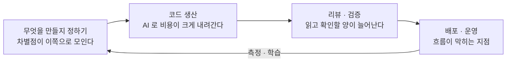

흔히 추천되는 CTO 필독서 목록이 있다. 열한 권이고, 모두 **AI 코딩 도구가 나오기 전에 쓰인 책이다.** 이 글은 그 목록을 다시 고른다. 기준은 하나다. 코드를 만드는 비용이 크게 내려갔을 때 그 책이 다루는 문제가 줄어드는가, 오히려 커지는가.

이 글은 **10년 차 이상 개발 리더가 프로덕트 리더십으로 역할을 넓히는 경우**를 염두에 두고 책을 골랐다. 개발 조직을 이끌던 사람이 무엇을 만들지, 어떤 팀 구조로 만들지, 잘 만들고 있는지를 함께 책임지게 되는 상황을 가정한다. 책의 가치를 일반적으로 매기는 글이 아니므로 다른 독자에게는 같은 책의 평가가 달라질 수 있고, 아래의 등급은 모두 이 글의 판단이다.

## 병목이 옮겨 가는 단계

소프트웨어는 여러 단계를 거쳐 나온다. AI 도구가 낮추는 것은 그중 코드를 쓰는 단계의 비용이다. 한 단계가 빨라지면 병목은 그 앞뒤 단계로 옮겨 간다. 앞뒤 단계는 만들어진 코드를 읽고 확인하는 일, 배포하고 운영하는 일, 애초에 무엇을 만들지 정하는 일이다. 이 일들을 맡을 팀을 어떻게 나눌지도 함께 문제가 된다.

| 병목 지점 | 달라지는 것 | 이 글에서 맡는 묶음 |
|---|---|---|
| 무엇을 만들지 정하기 | 만드는 비용이 내려가면 잘 고르는 쪽이 차별점이 된다 | 제품 |
| 코드 생산 | 비용이 내려간다. 개인 기법의 비중이 줄어드는 단계다 | 공학의 기본 |
| 리뷰 · 검증 | 사람이 읽고 확인해야 할 코드가 늘어난다 | 측정 · 공학의 기본 |
| 배포 · 운영 | 코드가 빨라진 만큼 흐름이 여기서 막힌다 | 측정 |
| 조직 설계 | 팀 하나가 감당할 코드와 시스템의 양이 달라진다 | 조직 |

이 틀은 짐작만으로 세운 것이 아니라, 측정 결과가 체감과 어긋난 사례에서 나온 것이다. [2024년 DORA 보고서](https://cloud.google.com/blog/products/devops-sre/announcing-the-2024-dora-report)는 **AI 도입이 늘어나면서 배포 처리량은 1.5%, 배포 안정성은 7.2% 낮아진 것으로 추정했다.** 같은 보고서는 AI 도입이 개인의 생산성, 몰입, 직무 만족을 크게 높였다는 결과도 함께 내놓았다([DORA 2024 보고서 페이지](https://dora.dev/research/2024/dora-report/)). 개인이 느끼는 속도와 시스템 전체의 결과가 서로 다른 방향으로 갈 수 있다는 뜻이다. [2025년 보고서](https://cloud.google.com/blog/products/ai-machine-learning/announcing-the-2025-dora-report)는 AI가 팀을 고쳐 주지 않고 이미 있는 강점과 약점을 키운다고 정리한다. 자동화된 테스트, 성숙한 버전 관리, 빠른 피드백 같은 장치가 없으면 늘어난 변경량이 불안정으로 이어진다고 본다. 같은 수치를 조직 설계 쪽에서 다룬 글이 [빌더에서 오케스트레이터로 가는 조직 설계](/blog/ai-transformation/builder-to-orchestrator-shift/)이다.

리뷰·검증을 비롯해 사람의 승인을 단계마다 어디에 두는지는 [요구사항에서 운영까지 여섯 게이트](/blog/ai-transformation/sdlc-human-gates/)가 정리한다. 이 글은 그 앞 단계, 즉 리더가 어떤 책으로 그 판단의 바탕을 쌓을지를 다룬다.

## 한눈에 보기

| 책 | 묶음 | 등급 | AI 시대 적합도 |
|---|---|---|---|
| 인스파이어드 (Inspired) | 제품 | 필독 | 높음 |
| Accelerate | 측정 | 필독 | 높음 |
| 팀 토폴로지 (Team Topologies) | 조직 | 필독 | 높음 |
| An Elegant Puzzle | 조직 | 필독 | 높음 |
| 개발 7년차, 매니저 1일차 (The Manager's Path) | 조직 | 추천 | 중간 |
| 하드씽 (The Hard Thing About Hard Things) | 조직 | 추천 | 중간 |
| 피닉스 프로젝트 (The Phoenix Project) | 측정 | 추천 | 중간 |
| 맨먼스 미신 (The Mythical Man-Month) | 공학의 기본 | 선택 | 높음 |
| 구글 엔지니어는 이렇게 일한다 (Software Engineering at Google) | 공학의 기본 | 선택 | 높음 |
| 린 스타트업 (The Lean Startup) | 제품 | 선택 | 높음 |
| 실용주의 프로그래머 (The Pragmatic Programmer) | 공학의 기본 | 선택 | 중간 |

열한 권 가운데 AI 시대 적합도가 높음인 책이 일곱 권, 중간인 책이 네 권이고, 필독 네 권은 측정·조직·제품 세 묶음에 나뉘어 있다. 등급과 적합도는 서로 다른 기준이어서, 선택으로 매긴 책 가운데에도 적합도가 높은 책이 셋 있다.

## 측정: 빨라졌다는 체감을 확인하기

코드가 빨리 나오면 팀이 빨라진 것처럼 느껴진다. 이 묶음은 그 체감이 맞는지 확인하는 책이다. 지표를 무엇으로 잡을지는 이 블로그의 [팀 공유 인프라 넷과 성숙도](/blog/ai-transformation/enablement-infra-and-maturity/) 편이 「무엇을 재는가」 절에서 속도·안정성·품질·채택 네 분류로 정리해 두었고, 아래 두 권은 그 지표를 읽는 방법과 병목을 찾는 방법을 준다.

### Accelerate (Forsgren · Humble · Kim): 필독 · 적합도 높음

한국어판은 『디지털 트랜스포메이션 엔진』이라는 제목으로 에이콘출판에서 2020년에 나왔고, 지금은 절판이다.

- **요지**: 소프트웨어 조직의 성과를 네 지표로 재고, 그 지표를 움직이는 역량과 조직 문화를 다루는 책이다.
- **핵심 개념**: 네 가지 지표(배포 빈도, 변경 리드 타임, 서비스 복구 시간, 변경 실패율), 24가지 역량, Westrum 조직 문화.
- **AI 시대에 읽으면**: AI 도입 효과를 재는 기준이 된다. 코드가 빨리 나와도 배포 빈도와 리드 타임이 그대로이거나 변경 실패율이 오른다면 체감만 빨라진 것이다. 속도 지표 둘과 안정성 지표 둘이 한 묶음으로 있다는 점이 중요하다. 한쪽만 보면 앞서 본 추정치처럼 개인의 체감과 시스템의 결과가 어긋나도 알아채지 못한다.
- **누구에게 맞는가**: 개발 조직의 성과를 숫자로 설명하고 AI 도입의 효과를 같은 기준으로 평가해야 하는 리더.
- **읽는 방식**: 네 지표와 조직 문화 부분을 먼저 읽는다. 24가지 역량은 처음부터 외우지 않고, 자기 조직에서 약한 곳을 찾는 점검표로 쓴다. 읽은 뒤에는 AI 도입 전후의 네 지표를 한 번 직접 재 본다.

### 피닉스 프로젝트 (The Phoenix Project): 추천 · 적합도 중간

한국어판은 에이콘출판에서 2021년에 나왔다. 저자는 Kim · Behr · Spafford이다.

- **요지**: 데브옵스를 소설로 소개하는 책이다. 설계서가 아니라 이야기이므로 아키텍처를 배우려는 책으로 읽으면 어긋난다.
- **핵심 개념**: 네 가지 일, 세 가지 방법, 제약 이론.
- **AI 시대에 읽으면**: 코드 생산이 빨라지면 병목은 리뷰·배포·운영으로 간다. 제약 이론은 막힌 곳부터 푸는 방법이라서 이 이동을 이해하는 데 그대로 쓸 수 있다. 책의 병목 인물 브렌트는 리뷰를 혼자 떠안은 시니어와 겹친다. AI가 코드를 쏟아 내도 읽을 사람이 한 명이면 전체 처리량은 그 한 명이 정한다. 중간으로 매긴 이유는 AI 이전의 운영 현실을 그린 책이라 처방이 AI에 맞춰져 있지 않고, 병목을 알아보는 방법만 준다는 점이다.
- **누구에게 맞는가**: 흐름이 막힌 곳을 팀과 개발 바깥의 이해관계자에게 설명해야 하는 리더.
- **읽는 방식**: 소설이므로 빠르게 읽는다. 읽으면서 자기 조직의 브렌트가 누구인지 한 줄로 적어 둔다.

## 조직: 늘어난 코드를 감당하는 구조

코드가 늘면 팀이 감당할 양이 늘고, 팀 규모와 경계를 정하던 기준도 흔들린다. 이 묶음의 네 권은 구조를 어떻게 나누고 키우고, 어려운 결정을 어떻게 내릴지를 다룬다. AI 때문에 직무가 어떻게 재정의되는지는 이 블로그의 [조직 설계 편](/blog/ai-transformation/builder-to-orchestrator-shift/)이 따로 다루므로 여기서는 책이 주는 틀에 집중한다.

### 팀 토폴로지 (Team Topologies): 필독 · 적합도 높음

한국어판은 에이콘출판에서 2020년에 나왔다. 원서는 2019년에 나왔고 2025년에 2판이 나왔으므로, 한국어판은 1판을 옮긴 것이다.

- **요지**: 팀을 어떤 유형으로 나누고 서로 어떻게 일하게 할지를 설계하는 책이다. 저자는 Skelton · Pais이다.
- **핵심 개념**: 네 가지 팀 유형, 세 가지 상호작용 방식, 인지 부하, 역콘웨이 전략.
- **AI 시대에 읽으면**: AI 코드가 늘수록 팀 하나가 이해하고 책임져야 할 코드의 양이 늘어난다. 그래서 인지 부하가 핵심 개념이 된다. 플랫폼 팀이 AI 도구와 가드레일을 제공하고 다른 팀이 그 위에서 일하는 구조는 이 책의 팀 유형으로 그대로 설명된다.
- **누구에게 맞는가**: 여러 팀의 경계를 다시 그려야 하는 리더. 프로덕트 조직으로 넓힐 때 제품 팀과 플랫폼 팀의 관계를 정하는 데도 쓰인다.
- **읽는 방식**: 팀 유형과 상호작용 방식을 먼저 읽고, 자기 조직의 팀을 네 유형에 하나씩 대응해 본다. 맞지 않는 팀이 나오는 곳이 조직의 문제 지점이다.

### An Elegant Puzzle (Will Larson): 필독 · 적합도 높음

한국어판은 『안녕하세요, 오늘부터 매니저입니다』라는 제목으로 길벗에서 2023년에 나왔다.

- **요지**: 엔지니어링 조직을 키우고 운영하는 문제를 시스템 사고로 풀어 가는 책이다.
- **핵심 개념**: 팀 규모, 팀의 네 가지 상태, 시스템 사고, 마이그레이션, 지표, 채용.
- **AI 시대에 읽으면**: 책이 팀 규모로 잡는 6~8명이라는 기준은 한 사람의 산출이 늘어난 지금 다시 따져 볼 대상이다. 책은 기준을 주는 쪽이고, 그 기준이 AI 이후에도 맞는지는 읽는 사람이 직접 확인해야 한다. 지표와 마이그레이션 부분은 AI 도구를 조직에 넣는 일 자체에도 적용된다.
- **누구에게 맞는가**: 조직의 크기와 구조를 직접 정해야 하는, 여러 팀을 맡은 리더.
- **읽는 방식**: 지금 부딪친 문제의 주제부터 읽는다. 읽을 때마다 6~8명이라는 기준을 자기 팀의 현재 산출에 맞춰 본다.

### 개발 7년차, 매니저 1일차 (The Manager's Path): 추천 · 적합도 중간

한국어판은 한빛미디어에서 2020년에 나왔다. 저자는 Camille Fournier이다.

- **요지**: 관리 역할을 단계별로 나누고 각 단계에서 요구되는 일을 설명하는 책이다.
- **핵심 개념**: 단계별 관리 역할.
- **AI 시대에 읽으면**: 여러 팀을 맡은 리더라면 여러 팀을 관리하는 단계 이후의 장이 읽을 만하다. 반면 AI가 주니어의 성장 경로와 테크리드의 역할을 바꾸는 부분은 이 책이 다루지 않는다. 적합도를 중간으로 둔 이유다.
- **누구에게 맞는가**: 관리 경험이 있어도 단계가 올라갈 때 무엇이 달라지는지를 정리하고 싶은 리더. 앞 단계의 장은 팀의 새 매니저에게 건네기에 맞다.
- **읽는 방식**: 앞 장은 훑고, 여러 팀을 관리하는 단계 이후의 장을 중심으로 읽는다.

### 하드씽 (The Hard Thing About Hard Things): 추천 · 적합도 중간

한국어판은 한국경제신문사에서 2021년에 다시 나왔다. 2014년에 나온 번역본은 절판이다. 저자는 Ben Horowitz이다.

- **요지**: 조직이 위기에 있을 때 내려야 하는 어려운 결정을 다루는 책이다.
- **핵심 개념**: 평시 CEO와 전시 CEO, 해고와 강등, 「사람, 제품, 수익」 순서.
- **AI 시대에 읽으면**: AI로 조직을 재편할 때 참고가 된다. 직무를 바꾸고 사람을 재배치하는 결정을 앞두고 있을 때 어떤 순서로 무엇을 우선하는지를 생각하게 한다. 재편의 구조 자체는 [조직 설계 편](/blog/ai-transformation/builder-to-orchestrator-shift/)이 다루고, 이 책은 그 결정을 내리는 사람의 입장에서 필요한 내용을 다룬다.
- **누구에게 맞는가**: 재편 결정을 직접 내려야 하는 위치의 리더. CEO의 관점에서 쓰인 책이므로 여러 팀을 맡은 독자는 자기 권한의 범위에 맞게 바꿔서 읽는다.
- **읽는 방식**: 조직 재편을 실제로 검토하는 시점에 읽는다. 미리 읽어 두기보다 결정을 앞두었을 때 가치가 크다.

## 제품: 무엇을 만들지가 차별점이 될 때

만드는 비용이 내려가면 모두가 비슷한 속도로 만들 수 있게 된다. 그때 남는 차이는 무엇을 만들 것인가다. 개발 리더가 프로덕트 리더십으로 넓힐 때 가장 먼저 보강해야 할 영역이기도 하다.

### 인스파이어드 (Inspired): 필독 · 적합도 높음

한국어판 제2판은 제이펍에서 2018년에 나왔다. 저자는 Marty Cagan이다.

- **요지**: 제품팀을 어떻게 구성하고 제품을 어떻게 발견하고 만드는지를 다루는 책이다.
- **핵심 개념**: 제품팀의 구성, 디스커버리와 딜리버리, 네 가지 리스크(가치, 사용성, 실현 가능성, 사업 타당성), 권한을 위임받은 팀.
- **AI 시대에 읽으면**: 딜리버리 비용이 낮아지면 디스커버리가 차별점이 된다. 네 리스크 가운데 실현 가능성은 AI가 낮추는 쪽에 있고, 가치·사용성·사업 타당성은 코드가 싸져도 그대로 남는다고 이 글은 본다. AI 프로토타입으로 빠른 검증이 쉬워지므로 디스커버리의 속도도 올릴 수 있다.
- **누구에게 맞는가**: 개발 조직에서 프로덕트 리더십으로 넓히는 리더. 이 글이 염두에 둔 독자에게는 첫 책이다.
- **읽는 방식**: 처음부터 끝까지 읽고, 자기 팀이 디스커버리를 실제로 하고 있는지 네 리스크에 하나씩 맞춰 본다. 이어서 후속작 『임파워드』(제이펍, 2021)로 간다.

### 린 스타트업 (The Lean Startup): 선택 · 적합도 높음

한국어판은 인사이트에서 2012년에 나왔다. 저자는 Eric Ries이다.

- **요지**: 만들고, 재고, 배우는 순환으로 불확실한 제품을 검증하는 방법을 다룬다.
- **핵심 개념**: 만들기-측정-학습, MVP, 검증된 학습, 허상 지표.
- **AI 시대에 읽으면**: MVP를 만드는 비용이 줄어 병목이 측정과 학습으로 옮겨 간다. 허상 지표는 AI 도입 보고에서도 그대로 나타난다. 사용량이 늘었다는 숫자가 곧 성과는 아니라는 경고다.
- **누구에게 맞는가**: 제품 검증의 순환을 팀에 심으려는 리더.
- **읽는 방식**: 개념이 이미 상식처럼 퍼져 있어 요약으로 충분할 수 있다. 인스파이어드를 읽은 뒤에 검증 순환의 용어를 보충하는 용도로 쓴다.

## 공학의 기본: 시대와 무관하게 남는 것

코드를 만드는 비용이 내려가도 소프트웨어가 가진 본질적인 어려움은 남는다. 이 묶음의 세 권은 모두 선택이다. 읽지 않아도 역할을 넓히는 데 막히지는 않지만, 읽으면 AI가 쏟아 내는 코드를 평가하는 기준이 생긴다.

### 맨먼스 미신 (The Mythical Man-Month): 선택 · 적합도 높음

한국어판은 인사이트에서 2015년에 나왔다. 저자는 Frederick Brooks이고, 원서는 1975년에 나왔다. 1995년 기념판에 「No Silver Bullet」이 다시 실렸다.

- **요지**: 소프트웨어 프로젝트가 왜 일정과 인력으로 풀리지 않는지를 다루는 고전이다.
- **핵심 개념**: 브룩스의 법칙, 개념적 무결성, 「은탄환은 없다」의 본질적 복잡성과 우연적 복잡성의 구분.
- **AI 시대에 읽으면**: AI는 우연적 복잡성을 줄이지만 본질적 복잡성은 남긴다. 에이전트를 더 붙여도 통합 비용이 남는다는 점에서 브룩스의 법칙은 새 형태로 되살아난다. 개념적 무결성은 여러 에이전트가 만든 코드가 하나의 설계로 보이는가를 묻는 기준이 된다.
- **누구에게 맞는가**: AI 에이전트를 병렬로 돌리는 팀의 일정과 통합 문제를 판단해야 하는 리더.
- **읽는 방식**: 낡은 장이 많으므로 「은탄환은 없다」와 핵심 장만 읽는다.

### 구글 엔지니어는 이렇게 일한다 (Software Engineering at Google): 선택 · 적합도 높음

한국어판은 한빛미디어에서 2022년에 704쪽으로 나왔고, 원서는 2020년에 나왔다. 원서는 [abseil.io에서 무료로 공개](https://abseil.io/resources/swe-book)되어 있다.

- **요지**: 구글이 코드를 오래 유지하며 일하는 방식을 공학 관행으로 정리한 책이다.
- **핵심 개념**: 시간에 걸쳐 통합된 프로그래밍, 하이럼의 법칙, 코드 리뷰·테스트·폐기.
- **AI 시대에 읽으면**: 코드가 빨리 늘수록 오래 유지할 코드의 부담도 같이 늘어난다. 시간에 걸쳐 본다는 관점은 이 부담을 다루는 틀이다. 코드 리뷰·테스트·폐기를 다루는 장은 앞서 본 리뷰·검증 병목과 겹친다.
- **누구에게 맞는가**: 코드베이스와 리뷰 체계의 수명을 책임지는 리더.
- **읽는 방식**: 분량이 많고 구글의 규모를 전제로 쓰였으므로 필요한 장만 읽는다. 무료 공개본이 있으니 필요한 장을 먼저 열어 보고 판단해도 된다.

### 실용주의 프로그래머 (The Pragmatic Programmer): 선택 · 적합도 중간

한국어판은 『실용주의 프로그래머 20주년 기념판』으로 인사이트에서 2022년에 나왔고, 원서 20주년판은 2019년이다. 저자는 Hunt · Thomas이다.

- **요지**: 개인 개발자의 작업 습관과 설계 기법을 모은 책이다.
- **핵심 개념**: DRY, 직교성, 예광탄, 「우연에 맡기는 프로그래밍」(Programming by Coincidence).
- **AI 시대에 읽으면**: 우연에 맡기는 프로그래밍은 동작하는 이유를 모른 채 코드를 받아들이는 일을 가리키는데, AI가 만든 코드를 이해 없이 받아들이는 위험과 맞물린다. 다만 개인 기법 위주라 리더에게는 비중이 작고, 적합도를 중간으로 둔 이유도 여기에 있다.
- **누구에게 맞는가**: 리더보다 팀원에게 권할 책이다.
- **읽는 방식**: 리더는 우연에 맡기는 프로그래밍 대목만 읽고, 나머지는 팀원에게 건넨다.

## 읽는 순서

열한 권을 다 읽을 시간은 드물다. 이 글이 염두에 둔 독자가 역할을 넓히는 순서를 따르면 아래와 같다.

| 순서 | 책 | 왜 이 순서인가 |
|---|---|---|
| 1 | 인스파이어드 | 무엇을 만들지가 차별점이라는 틀을 먼저 세운다 |
| 2 | Accelerate | 만들기로 한 것을 얼마나 잘 내보내는지 재는 기준을 얻는다 |
| 3 | 팀 토폴로지 | 지표가 나쁜 이유를 구조에서 찾을 때 팀의 경계와 인지 부하를 본다 |
| 4 | An Elegant Puzzle | 구조를 바꿀 때의 팀 규모, 마이그레이션, 채용을 실제 업무에 적용한다 |
| 5 | 하드씽 | 여유가 있으면, 조직 재편 결정을 앞둔 시점에 읽는다 |
| 6 | 피닉스 프로젝트 | 여유가 있으면, 병목을 팀과 같은 언어로 이야기하려고 읽는다 |

여섯 권 밖의 다섯 권(개발 7년차 매니저 1일차, 맨먼스 미신, 구글 엔지니어는 이렇게 일한다, 린 스타트업, 실용주의 프로그래머)은 순서에 넣지 않았다. 필요한 장이 생겼을 때 꺼내 읽는 쪽이 낫다.

## 목록 밖에서 함께 볼 자료

- **『트랜스폼드』(Transformed, Marty Cagan)**: 한국어판은 제이펍에서 2024년에 나왔다. 인스파이어드의 저자가 회사 전체를 제품 중심의 운영 방식으로 바꾸는 과정을 다룬 책이다. 열한 권에는 넣지 않았지만, 인스파이어드를 읽은 뒤 팀을 넘어 회사 전체의 전환으로 관심을 넓힐 때 이어서 볼 만하다.
- **DORA 연구 보고서**: AI 도입이 개발 조직의 성과에 어떤 영향을 주는지 해마다 조사하는 보고서다. 앞에서 인용한 2024년 · 2025년 결과는 [DORA 공식 사이트](https://dora.dev/)에서 볼 수 있다. Accelerate의 네 지표로 AI 도입 이후의 변화를 점검할 때 함께 읽는다.

## 맺음

코드를 만드는 비용이 내려가면 책의 가치는 두 갈래로 갈린다. 측정, 조직, 제품을 다루는 책은 병목이 옮겨 간 단계를 직접 다루므로 가치가 오히려 커진다. 개인의 코딩 기법을 다루는 책은 AI가 그 일부를 가져가므로 비중이 줄어든다.

이 글의 평가는 10년 차 이상 개발 리더를 독자로 둔 결과다. 같은 열한 권도 독자가 바뀌면 순서가 바뀐다. 다만 어떤 독자라도 책을 읽는 방식은 같다. 읽기 전에 자기 조직의 병목이 지금 코드 생산, 리뷰·검증, 배포·운영, 무엇을 만들지 정하는 일 가운데 어디에 있는지를 먼저 확인하고, 그 부분을 다루는 책부터 꺼낸다.
